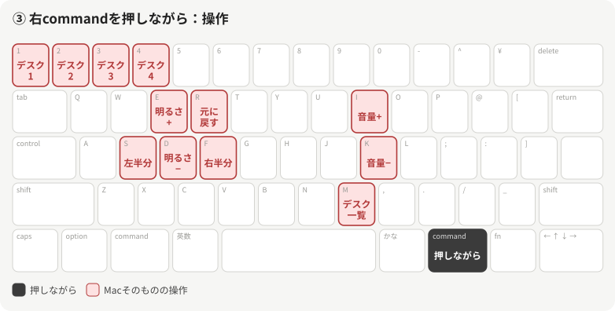

Macのキーボードは、矢印キーもEnterもBackspaceも、ホームポジションからちょっと遠い。カーソルを1文字戻すたびに右手が右下へ旅に出て、戻ってきたら指の位置がずれている。

自分はKarabiner-Elementsでキーの配置をかなりいじっていて、人に説明するときに毎回「えーと、右のcommandを押しながら……」となるので、まとめて「親指レイヤー式」と呼ぶことにした。

この記事では、どういう考えで配置を決めているかだけを書く。具体的な設定は設定編に分ける。考え方に乗れそうなら、設定編へ進んでもらえればいい。

前提として、JIS配列のMac（MacBookの内蔵キーボードやMagic Keyboard）を想定している。スペースの両隣にある「英数」「かな」キーを使うので、US配列だとそのままは真似できない。

## 先に結論：図で見る親指レイヤー式

何も押していないとき、親指の「英数」「かな」の位置が `command` になる。押してすぐ離すと Enter と Backspace。

`control` を押しっぱなしにすると、右手がカーソルキーになる。

右 `command`（かなの位置）を押しっぱなしにすると、音量や明るさ、ウィンドウの配置を操作できる。

図はキーボードを簡略化している。ここから下は、なぜこう配置したかの話。

## 考え方は2つだけ

1. ホームポジションから手を離さない（そのために親指を働かせる）
2. 修飾キー1つに役割は1つ

これ以外は、この2つから出てくる細かい決めごと。

## 1. ホームポジションから手を離さない

手がホームポジションから離れる原因は、だいたい決まっている。矢印、Enter、Backspace、Esc、PageUp / PageDown。どれもキーボードの端にあって、押すたびに手が動く。これらを、手を置いたまま届く位置に持ってくる。

### 親指が遊んでいる

JIS配列のMacでは、スペースの両隣が「英数」と「かな」になっている。親指が一番自然に届く場所なのに、やっていることはIMEの切り替えだけ。もったいない。

親指レイヤー式では、ここを `command` と入れ替える。スペースの左隣が左 `command`、右隣が右 `command` になる。`command + C` や `command + V` を、親指を少し曲げるだけで押せる。

さらに、押してすぐ離したとき（単押し）だけ別のキーとして扱う。

- 左親指の単押し → Enter
- 右親指の単押し → Backspace
- 押しっぱなしにして他のキーと組み合わせる → 普通の `command`

Enterは右手の小指、Backspaceは右手を上に伸ばして押すキーだったのが、どちらも親指の位置で押せる。入力中に一番よく押すのはたぶんこの2つなので、効果が大きい。

追い出された「英数」「かな」は、元の `command` の位置（スペースから2つ隣）に移す。押す回数は減るけど、届かなくなるわけではない。

### 矢印は control で

Aの左にある `control` を押しながら、右手の `j` / `i` / `k` / `l` で矢印になる。`i` が上、`k` が下、`j` が左、`l` が右。キーボードの矢印キーと同じ逆T字の並びなので、覚えるというより見たまま。

`shift` を足せば選択、`option` を足せば単語単位、`command` を足せば行頭・行末になる。普段の矢印キーと修飾キーの組み合わせがそのまま使えるので、新しく覚えることはほとんどない。

## 2. 修飾キー1つに役割は1つ

キーを足していくと、どこに何を入れたか分からなくなる。なので、押しっぱなしにする修飾キーごとに「何系の操作か」を決めてしまう。

| 押しっぱなしにするキー | 役割 | 例 |
|---|---|---|
| `control` | カーソル（文字の上を動く） | 矢印、PageUp / PageDown、行頭 / 行末、戻る / 進む、IMEのオン / オフ |
| 左 `command` | macOS標準のショートカット | コピー、貼り付け、保存。ここは何も変えない |
| 右 `command` | 操作（Macそのものを触る） | 音量、画面の明るさ、ウィンドウを左右半分に配置 |
| 右 `command` + 左 `command` | 起動 | アプリの頭文字で起動 |

左右の `command` で役割を分けているのがポイントで、右 `command` + キーはmacOS標準のショートカットとしては使わない。標準のショートカットは左手の親指で押す、と決めてしまえば迷わない。逆に、組み合わせを混ぜることはしない（右 `command` + `control` のような割り当ては作らない）。

`control` をカーソル担当にしたのは、macOSがもともとそういう使い方をしているから。`control + a` で行頭、`control + e` で行末、`control + d` で1文字削除、というEmacs由来のキーが標準で効く。そこに矢印やPageUpを足しても、同じ「文字の上の操作」の仲間なので収まりがいい。Macのショートカットの役割分担は[Macのキーボードショートカットを把握する]()にまとめてある。

### 位置で覚える

レイヤーの中でも、キーの位置に意味を持たせる。

- 右 `command` + `i` / `k` で音量の上げ / 下げ。カーソルの上下と同じキー
- 右 `command` + `e` / `d` で明るさの上げ / 下げ。左手側の上下
- 右 `command` + `s` / `f` でウィンドウを左 / 右半分に配置。左手側の左右

「上げる」は上の段、「左」は左の指。これくらい単純にしておくと、使わない期間があっても思い出せる。

ちなみに右 `command` + `a` で音声の出力先を選ぶ、みたいな凝った割り当てもある（[Macの音声出力先を1キーで出して矢印キーで選ぶ]()）。この手のものは別のツールやスクリプトに頼っているので、親指レイヤー式の本体からは外している。

## 設定編へ

考え方は以上。Windowsでも同じ物理キーに同じ操作が来るようにAutoHotkeyで揃えているけど、それはまた別の話。

Karabiner-Elementsでの具体的な設定は、設定編で書く。
