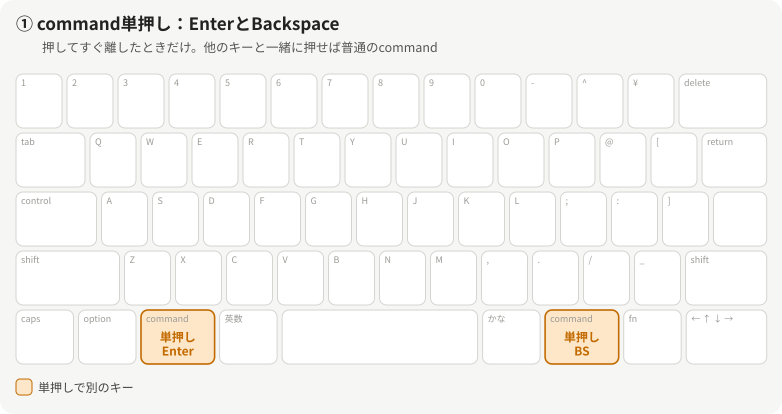
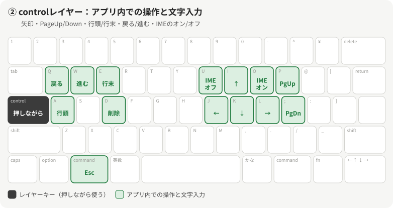

キーボードの矢印キーもEnterもBackspaceも、ホームポジションからちょっと遠い。カーソルを1文字戻すたびに右手が右下へ旅に出て、戻ってきたら指の位置がずれている。

自分はキーの配置をかなりいじっている。名前がないと説明しにくいので、まとめて「seiha式キーバインド」と呼ぶことにした。

この記事では、どういう考えで配置を決めているかだけを書く。具体的な設定は設定編に分ける。考え方に乗れそうなら、設定編へ進んでもらえればいい。

考え方はOSに関係ない。例はMac（JIS配列）のキー名と図で書く。Windowsなら、`control`をCaps Lockの位置、`command`をスペースの近くの親指キーに読み替えればいい。

## 全体像

左右の`command`は、押してすぐ離すとEnterとBackspaceになる。

`control`を押しているあいだは、ほかのキーの役割が切り替わる。この状態を「レイヤー」と呼ぶことにする。controlレイヤーには、アプリ内での操作と、IMEの切り替えなどの文字入力まわりを集めている。

右commandレイヤーには、音量や明るさ、ウィンドウの配置のような、Mac全体に効く操作を集めている。

図はキーボードを簡略化している。考え方は次の2つだけで、ここから下はなぜこう配置したかの話。

1. ホームポジションから手を離さない
2. 修飾キー1つに役割は1つ

## 考え方1：ホームポジションから手を離さない

手がホームポジションから離れる原因は、だいたい決まっている。矢印、Enter、Backspace、Esc、PageUp / PageDown。どれもキーボードの端にあって、押すたびに手が動く。これらを、手を置いたまま届く位置に持ってくる。

### EnterとBackspaceは親指で

`command`はスペースの近くにあって、親指で押せる。でも普段は他のキーと組み合わせるときにしか使わない。単独で押したときは何も起きないので、そこを空き地として使う。

- 左`command`の単押し → Enter
- 右`command`の単押し → Backspace
- 押しながら他のキーを押す → 普通の`command`

Enterは右手の小指、Backspaceは右手を上に伸ばして押すキーだったのが、どちらも親指で押せる。入力中に一番よく押すのはたぶんこの2つなので、効果が大きい。

### 矢印はcontrolで

Aの左にある`control`を押しながら、右手の`i` / `j` / `k` / `l`で矢印になる。`i`が上、`k`が下、`j`が左、`l`が右。キーボードの矢印キーと同じ逆T字の並びなので、覚えるというより見たまま。

`shift`を足せば選択、`option`を足せば単語単位、`command`を足せば行頭・行末になる。普段の矢印キーと修飾キーの組み合わせがそのまま使えるので、新しく覚えることはほとんどない。

## 考え方2：修飾キー1つに役割は1つ

キーを足していくと、どこに何を入れたか分からなくなる。なので、レイヤーごとに「何を入れるか」の基準を決めてしまう。基準は、その操作が効く範囲。

- **左`command`（そのまま）**：アプリの機能。コピーや保存など、macOS標準のショートカット。ここは何も変えない
- **controlレイヤー**：アプリ内と文字入力。矢印、PageUp / PageDown、行頭 / 行末、戻る / 進む、IMEのオン / オフ
- **右commandレイヤー**：Mac全体。音量、明るさ、ウィンドウの配置、デスクトップの切り替え
- **起動レイヤー（右`command` + 左`command`）**：アプリの外。アプリを開く

新しい割り当てを足すときも、この分け方で入れる場所が決まる。アプリ内で効くならcontrolレイヤー、どのアプリを開いていても同じ結果になるなら右commandレイヤー。

ただ、IMEの切り替えは本当はMac全体に効く。文字を打つ流れで押すので、例外としてcontrolレイヤーに置いている。

ちなみにMacでは、`command` + キーは「目に見える操作」（普通のショートカット）、`control` + キーは「目に見えない補助操作」や文字列操作に使われている（[Macのキーボードショートカットを把握する]()）。`control` + `a`で行頭、`control` + `e`で行末、というEmacs由来のキーも標準で効くので、controlレイヤーに矢印やPageUpを足しても収まりがいい。

左右の`command`で役割を分けているのもポイントで、右`command`はmacOS標準のショートカットには使わない。標準のショートカットは左`command`で押す、と決めてしまえば迷わない。レイヤー同士を混ぜることもしない（右`command` + `control`のような割り当ては作らない）。

### 位置で覚える

レイヤーの中でも、キーの位置に意味を持たせる。

- 右`command` + `i` / `k`で音量の上げ / 下げ。カーソルの上下と同じキー
- 右`command` + `e` / `d`で明るさの上げ / 下げ。左手側の上下
- 右`command` + `s` / `f`でウィンドウを左 / 右半分に配置。左手側の左右

「上げる」は上の段、「左」は左の指。これくらい単純にしておくと、使わない期間があっても思い出せる。

ちなみに右`command` + `a`で音声の出力先を選ぶ、みたいな凝った割り当てもある（[Macの音声出力先を1キーで出して矢印キーで選ぶ]()）。この手のものは別のツールやスクリプトに頼っているので、seiha式の本体からは外している。

## 代償

いいことばかりではない。ただ、どれくらい痛いかは使い方でかなり変わる。自分に当てはまる行だけ見てもらえればいい。

- **大**：ターミナルやVimをよく使う人。`control` + `l`（画面クリア）など、`control`の標準キーの一部が使えなくなる
- **中**：チャットをよく使う人。`command`を押しかけてやめただけでEnterが出て、送信してしまうことがある
- **中**：右`command`でショートカットを押す癖がある人。右`command` + `v`で貼り付け、などが効かなくなる
- **小**：Karabinerの入っていないMacも触る人。`command`の単押しでEnterが出ないので、指が迷う
- **小**：全員。Backspaceを押しっぱなしにしても連続で消えない

細かい話は以下に畳んでおく。

使えなくなるcontrolキー

controlレイヤーは全アプリで効くので、もともと`control`に割り当てられていたものが上書きされる。

- macOSのテキスト編集：`control` + `k`（行末まで削除）、`control` + `p`（前の行）、`control` + `o`（行を挿入）、`control` + `y`（貼り付け）
- ターミナル：`control` + `l`（画面クリア）、`control` + `u` / `w`（行・単語の削除）、`control` + `p`（コマンド履歴）
- Vim：`control` + `o` / `i` / `u` / `w`

`control` + `a` / `e` / `d`は上書きしていないので、そのまま使える。

commandの単押しの癖

- 押してから200ミリ秒以内に離すとEnter（Backspace）になる。`command`を押しかけてやめただけでもEnterが出るので、チャットだと送信してしまう
- Karabinerの単押し（`to_if_alone`）はキーリピートが効かない。右`command`を押しっぱなしにしてもBackspaceは1回分だけで、連続で消すときは元のdeleteキーを押す
- 押している間にクリックやスクロールをすれば単押し扱いにならないので、`command` + クリックでEnterが出ることはない

右commandで効かなくなるショートカット

右commandレイヤーに使っているので、そのキーは右`command`では標準ショートカットにならない。今の割り当てでは`s`（保存）、`f`（検索）、`r`、`w`（閉じる）、`x` / `v`（切り取り / 貼り付け）、`a`（全選択）、`d`、`e`、`i`、`k`、`m`、`t`、`h`、`1`〜`4`が対象。標準ショートカットは左`command`で押す、と割り切っている。

環境まわり

- 仮想マシン（Parallelsなど）やリモートデスクトップの中では割り当てがぶつかるので、そのアプリを除外する設定が要る
- Karabinerの入っていないMacでは、`command`の単押しも`control` + `i` / `j` / `k` / `l`も効かない

## 設定編へ

考え方は以上。Karabiner-Elementsでの具体的な設定は、設定編で書く。

自分はさらに「英数」「かな」と`command`の位置を入れ替えて、`command`を親指のすぐ横に持ってきている。Windowsでも同じ物理キーに同じ操作が来るようにAutoHotkeyで揃えている。どちらもそれぞれ別の話なので、また別の記事で。
